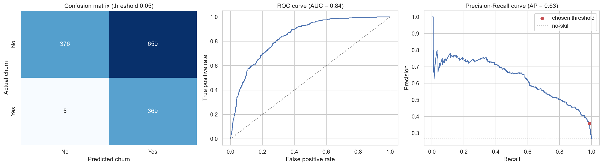
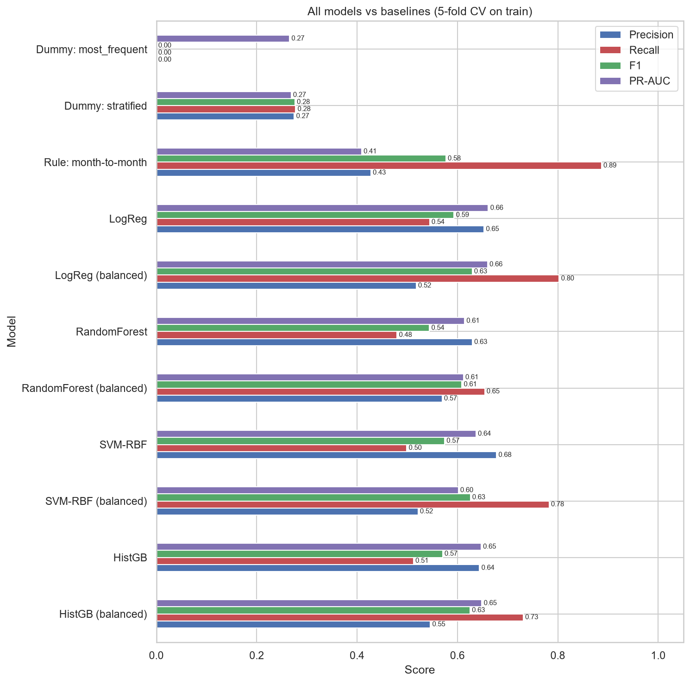
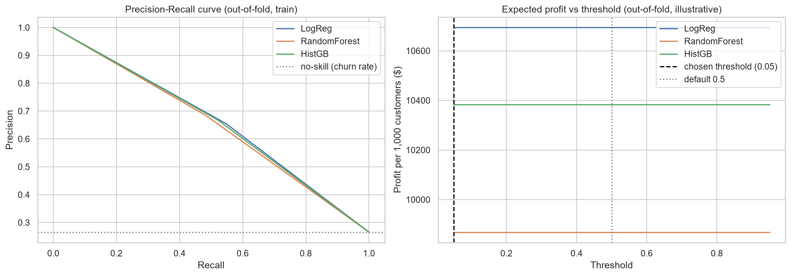

# Customer Churn Prediction


End-to-end machine learning project that predicts which telecom customers will leave, picks the decision threshold from a retention-campaign profit model, and segments customers with PCA + K-Means.

## Problem

A telecom company loses about 1 in 4 customers. Winning back a lost customer is expensive, but contacting everyone with a retention offer is too. The goal is to rank customers by churn risk, decide whom to contact, and understand what drives churn, using the public *Telco Customer Churn* dataset from Kaggle (7,043 customers, 19 features, 26.5% churn).

## Demo



| Model comparison (5-fold CV) | Expected profit vs threshold |
|---|---|
|  |  |

## Tech stack

Python, pandas, NumPy, scikit-learn (Pipeline, ColumnTransformer, GridSearchCV), SciPy, matplotlib, seaborn, joblib, pytest, JupyterLab.

## Quick Start

Score a sample customer with the saved model (no dataset needed):

```bash
git clone https://github.com/Sheyda-Fathi/customer-churn-prediction.git && cd customer-churn-prediction
python -m venv .venv && .venv\Scripts\activate        # Linux/macOS: source .venv/bin/activate
pip install -r requirements.txt
python -m src.predict --json examples/sample_customer.json
```

Expected output (a new fiber customer on a month-to-month contract):

```json
{
  "probability": 0.591,
  "churn": true,
  "threshold": 0.05
}
```

`churn` is `true` when the probability is at least the saved threshold. The model and its metadata (threshold, columns, library versions) are in `models/`.

### Reproduce the full analysis

1. Download *Telco Customer Churn* from [Kaggle](https://www.kaggle.com/datasets/blastchar/telco-customer-churn) and save the CSV as `data/raw/WA_Fn-UseC_-Telco-Customer-Churn.csv` (the file is not redistributed here).
2. Run the tests: `python -m pytest -q`
3. Run the notebooks in order (the full run takes a few minutes, tuning is the slowest part):
   ```bash
   jupyter nbconvert --to notebook --execute --inplace notebooks/01_eda.ipynb notebooks/02_baseline.ipynb notebooks/03_modeling.ipynb notebooks/04_clustering.ipynb
   ```
4. Retrain and save the model: `python -m src.train`

## How it works

1. **Clean and split.** One fixed cleaning rule (`TotalCharges` is blank only for brand-new customers, so it becomes 0), then an 80/20 stratified split with a fixed seed. The test set is used once, at the very end.
2. **Pipeline.** Imputation, scaling and one-hot encoding live inside a scikit-learn `Pipeline`, so they are fitted on training folds only (no data leakage).
3. **Baselines and models.** Majority class, random guess, a month-to-month rule, then Logistic Regression, Random Forest, SVM and Gradient Boosting, each with and without class weights, all scored with the same 5-fold stratified CV.
4. **Tuning.** Grid / randomized search selected by **PR-AUC**, because it does not depend on a threshold and fits a 26.5% positive class.
5. **Threshold by profit.** Out-of-fold probabilities and a simple profit model (illustrative: retained customer worth $500, offer costs $50, offer works for 30% of churners) choose the decision threshold.
6. **Explain and evaluate.** Permutation importance on held-out folds, one final test-set evaluation with bootstrap intervals, and customer segments with PCA + K-Means.

## Results

### Model comparison (5-fold CV on the training set, default threshold 0.5)

| Model | Setting | F1 | Precision | Recall | ROC-AUC | PR-AUC |
|---|---|---|---|---|---|---|
| Always "No churn" | baseline | 0.000 ± 0.000 | 0.000 | 0.000 | 0.500 | 0.265 ± 0.000 |
| Random guess | baseline (class rates) | 0.276 ± 0.025 | 0.275 | 0.278 | 0.506 | 0.269 ± 0.007 |
| Month-to-month rule | baseline (fixed rule) | 0.577 | 0.427 | 0.887 | 0.729 | 0.409 |
| Logistic Regression | defaults | 0.593 ± 0.030 | 0.653 | 0.544 | 0.846 | 0.661 ± 0.019 |
| Logistic Regression | defaults + `class_weight=balanced` | 0.629 ± 0.022 | 0.518 | 0.803 | 0.846 | 0.660 ± 0.019 |
| Random Forest | defaults | 0.544 ± 0.028 | 0.630 | 0.480 | 0.822 | 0.614 ± 0.028 |
| Random Forest | defaults + `class_weight=balanced` | 0.540 ± 0.024 | 0.632 | 0.472 | 0.823 | 0.613 ± 0.031 |
| SVM (RBF) | defaults | 0.574 ± 0.015 | 0.678 | 0.499 | 0.797 | 0.637 ± 0.021 |
| SVM (RBF) | defaults + `class_weight=balanced` | 0.626 ± 0.022 | 0.521 | 0.783 | 0.826 | 0.602 ± 0.029 |
| Hist. Gradient Boosting | defaults | 0.571 ± 0.028 | 0.644 | 0.514 | 0.838 | 0.647 ± 0.022 |
| Hist. Gradient Boosting | defaults + `class_weight=balanced` | 0.625 ± 0.019 | 0.547 | 0.731 | 0.837 | 0.646 ± 0.028 |
| Logistic Regression | **tuned**: `C=3` | 0.596 ± 0.031 | 0.655 | 0.547 | 0.846 | 0.662 ± 0.019 |
| Random Forest | **tuned**: `max_depth=None, min_samples_leaf=20` | 0.567 ± 0.014 | 0.685 | 0.484 | 0.848 | 0.665 ± 0.021 |
| Hist. Gradient Boosting | **tuned**: `l2_regularization=0.1, learning_rate=0.026, max_iter=300, max_leaf_nodes=4, min_samples_leaf=50` | 0.588 ± 0.019 | 0.671 | 0.523 | 0.849 | 0.669 ± 0.021 |

- Every model clearly beats the baselines on ROC-AUC and PR-AUC.
- After tuning, the three model families are tied on PR-AUC (0.66 to 0.67, CV std about 0.02). The simplest one, Logistic Regression, was chosen by a rule fixed in advance.
- Class weights raise recall at the cost of precision. For Logistic Regression and Gradient Boosting they leave ROC-AUC and PR-AUC unchanged, so they mostly move the operating point; the threshold does the same job in a controlled way.
- Fitting time is not a differentiator: one fit on the 5,634 training rows takes about 0.1 s (Logistic Regression), 0.5 s (Gradient Boosting) and 1.3 s (Random Forest) on one CPU core.

### Final model on the held-out test set (1,409 customers)

Logistic Regression (`C=3`), decision threshold **0.33**, chosen on the training set only.

| Metric | Test | 95% bootstrap interval |
|---|---|---|
| Precision | 0.536 | 0.491 to 0.577 |
| Recall | 0.719 | 0.674 to 0.763 |
| F1 | 0.614 | 0.572 to 0.649 |
| ROC-AUC | 0.842 | 0.819 to 0.863 |
| PR-AUC | 0.630 | 0.579 to 0.683 |

The model finds 269 of 374 churners (105 missed) with 233 false alarms. The month-to-month rule has a similar F1 (0.574 on the test set) but a much lower PR-AUC (0.406) and precision (0.426).

Illustrative profit per 1,000 customers: about **$10.8k** (interval $8.2k to $13.3k), against a loss of about $10.2k for contacting everyone. The dollar values come from made-up assumptions; replace them with company figures.

### What drives churn

Top 5 features by permutation importance (average rank across the three tuned models):

| # | Feature | What the data shows |
|---|---|---|
| 1 | `tenure` | 52.9% churn in the first 6 months, 9.5% after 4 years |
| 2 | `Contract` | month-to-month 42.7%, one-year 11.3%, two-year 2.8% |
| 3 | `InternetService` | fiber 41.9%, DSL 19.0%, no internet 7.4% |
| 4 | `MonthlyCharges` | churners pay about $74 on average, others about $61 |
| 5 | `TotalCharges` | roughly `tenure` x `MonthlyCharges`; adds little on its own |

These are associations, not causes.

### Customer segments (K-Means, K=3)

| Cluster | Segment | Share | Churn | Profile |
|---|---|---|---|---|
| 0 | Phone-only, low bill | 21.6% | 7.2% | No internet, about $21/month, often a two-year contract |
| 1 | Loyal full-service | 34.3% | 15.6% | About 57 months of tenure, about $89/month, mostly fiber, has tech support |
| 2 | New, month-to-month | 44.2% | 44.5% | About 15 months of tenure, 88% month-to-month, 78% without tech support |

K=4 isolates a high-risk group (fiber, month-to-month, 26% of customers) with **57.8%** churn. Separation is moderate (silhouette 0.27); see `notebooks/04_clustering.ipynb`.

## Project structure

```
customer-churn-prediction/
├── data/raw/                # dataset goes here (not in the repo)
├── examples/sample_customer.json
├── models/                  # churn_pipeline.joblib + metadata.json
├── notebooks/
│   ├── 01_eda.ipynb         # data audit, TotalCharges fix, churn patterns
│   ├── 02_baseline.ipynb    # split and baselines
│   ├── 03_modeling.ipynb    # models, CV, tuning, threshold, importance, test
│   └── 04_clustering.ipynb  # PCA + K-Means segments
├── reports/                 # result tables (CSV/JSON) and figures
├── src/
│   ├── data.py              # load, clean, split
│   ├── pipeline.py          # preprocessing pipeline
│   ├── models.py            # candidate models
│   ├── evaluate.py          # shared CV and scoring
│   ├── tuning.py            # search spaces
│   ├── business.py          # campaign profit model
│   ├── threshold.py         # threshold by expected profit
│   ├── importance.py        # permutation importance
│   ├── clustering.py        # PCA / K-Means helpers
│   ├── train.py             # train and save the final model
│   └── predict.py           # load the model and score customers
├── tests/                   # pytest suite
├── pytest.ini
└── requirements.txt
```

## What I learned

- **Leakage is easy to cause and hard to see.** Putting every preprocessing step inside a `Pipeline` removes the most common source.
- **Accuracy is a trap on imbalanced data.** "Always No churn" scores 73.5% accuracy and finds nobody.
- **Class weights move the threshold, not the model.** ROC-AUC and PR-AUC did not change, so I judged models by PR-AUC and set the threshold separately.
- **A simple model can be enough.** After tuning, Logistic Regression was as good as Random Forest and Gradient Boosting, and easier to explain.
- **Decide the rule before looking.** Fixing the model-selection rule and the threshold before touching the test set kept the final numbers honest, even when the default threshold happened to look slightly better on the test sample.
- **Turn metrics into decisions.** A small cost/benefit model made the precision/recall trade-off concrete.

## Limitations and future work

- The profit figures use illustrative assumptions, not real company costs.
- One dataset from one company, no time dimension; the test set has 1,409 rows, so intervals are wide.
- Feature effects are associations. Measuring the effect of retention offers needs an experiment (A/B test).
- K-Means on one-hot columns gives only moderate separation; K-Prototypes or Gower distance may work better.
- Next steps: serve the model through a FastAPI service with Docker, add CI (tests and lint on every push), experiment tracking (MLflow), SHAP explanations, probability calibration and nested cross-validation.

## Data

The *Telco Customer Churn* dataset (originally an IBM sample dataset) is published on Kaggle. It is not included in this repository; see the Kaggle page for its terms.
